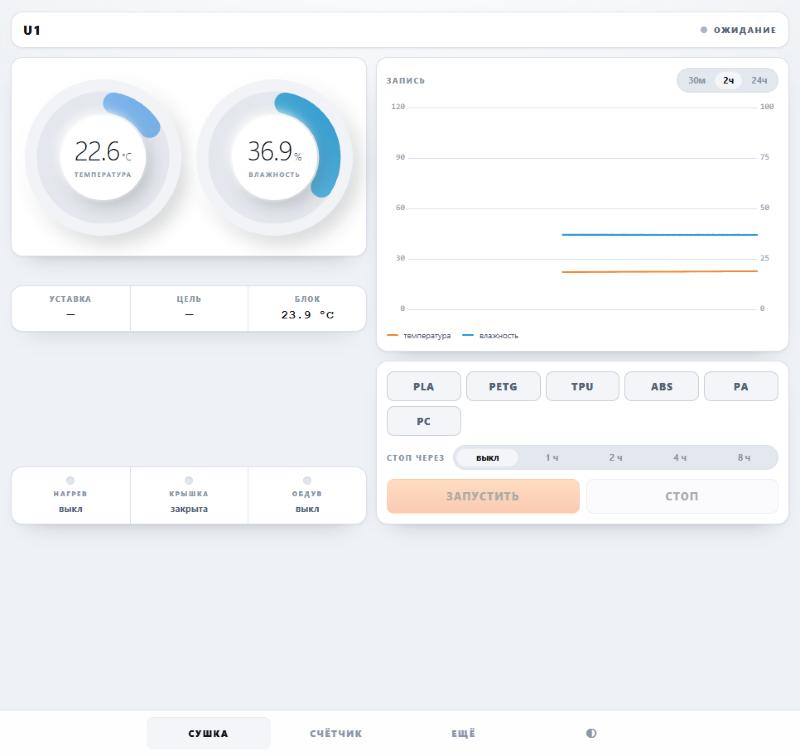

# PyUnit Dashboard

Панель управления и визуализация для сушилки филамента на **[PyUnit](https://github.com/xatang/PyUnit)**.

> Это **надстройка**, а не замена. Прошивка, управление нагревом, PID и вся логика сушки —
> это PyUnit, автор **[xatang](https://github.com/xatang)**. Этот проект ставится рядом с
> ним, ничего в нём не меняет и пользуется его же API.
>
> An add-on dashboard for [xatang/PyUnit](https://github.com/xatang/PyUnit) (iDryer Unit firmware).
> It runs next to PyUnit, does not modify it and talks to its API. All credit for the firmware
> goes to the original author.



## Что добавляет

- **Кольцевые шкалы** температуры (0–120 °C) и влажности (0–100 %); цвет кольца зависит от
  показания: холодная камера — голубая, прогретая — янтарная и красная. Метка уставки на кольце.
- **Таймер «стоп через 1 / 2 / 4 / 8 ч»**. Работает на устройстве, а не в браузере:
  уснувший телефон не оставит сушилку греть. Таймер только останавливает, нагрев сам не включает.
- **Ход сушки понятным языком**: на прогреве — сколько уже идёт, на выдержке —
  прошло / осталось / «готово в 18:40».
- **Счётчик сушек** — общий и по материалам, со списком последних сушек.
- **Самописец** температуры и влажности за 30 минут / 2 часа / сутки.
- **Для телефона**: раскладка под узкий экран, светлая и тёмная темы, установка на
  главный экран Android (PWA).
- Редактирование пресетов, журнал и настройки остаются в PyUnit — на них ведёт раздел «Ещё».

## Установка

Нужен уже установленный и запущенный PyUnit ([инструкция](https://github.com/xatang/PyUnit#-quick-start)).
На том же устройстве:

```bash
curl -fsSL https://raw.githubusercontent.com/GNUGiminot/pyunit-dashboard/main/install.sh | bash
```

Или из клона, как принято у PyUnit:

```bash
git clone https://github.com/GNUGiminot/pyunit-dashboard.git
cd pyunit-dashboard
./install.sh
```

Откройте адрес, который скрипт напечатает в конце, — обычно `http://IP-УСТРОЙСТВА:5001`.

Установщик сам:

- находит запущенный PyUnit и берёт у его контейнера каталог с базой и порт — вводить ничего не нужно;
- работает и с `docker compose`, и со старым `docker-compose`; при необходимости — через `sudo`;
- выбирает свободный порт (5001, если занят — следующий);
- поднимает два контейнера и проверяет, что интерфейс, связь с PyUnit и счётчик отвечают.

Параметры, если автоопределение не подошло: `--port`, `--dir`, `--pyunit-dir`, `--pyunit-port`
(см. `./install.sh --help`).

**Обновление** — та же команда ещё раз. Настройки и история сушек сохраняются.

**Удаление** — `~/pyunit-dashboard/uninstall.sh` (история сушек остаётся в томе Docker)
или `uninstall.sh --purge` (удалить всё). PyUnit не затрагивается.

## Как это устроено

```
Телефон / ПК
   │
   ├─ :5001 ─► pyunit-dashboard-ui (nginx) ─┬─ /            интерфейс (HTML/CSS/JS, без сборки)
   │                                         ├─ /api, WS ──► PyUnit
   │                                         └─ /stats ────► pyunit-dashboard-stats
   │
   └─ :5000 ─► PyUnit (оригинальный интерфейс, редактирование и настройка)
                  └─► Moonraker ─► Klipper ─► нагреватель, заслонка, датчик
```

- **`pyunit-dashboard-ui`** — nginx: отдаёт интерфейс и пробрасывает запросы к PyUnit, поэтому
  браузер видит один адрес и настройка CORS не нужна.
- **`pyunit-dashboard-stats`** — небольшой сервис на Python (только стандартная библиотека):
  счётчик сушек и таймер останова.

## Важно знать

**Счётчик копит историю сам.** PyUnit при каждом запуске очищает свою таблицу телеметрии
(`CLEAR_LOGS_ON_STARTUP=True` в его `.env`), поэтому брать историю оттуда нельзя. Сервис
счётчика читает свежие записи (только на чтение) и хранит сессии в своей базе. История
начинается с момента установки панели.

**Таймер пресета в PyUnit стартует не с нажатия «Запустить».** Сначала идёт прогрев до
целевой влажности, и только потом отсчитывается `dry_time`. Поэтому сушка всегда длиннее
`dry_time`. Панель показывает это явно, а таймер «стоп через N ч» считает от момента установки.

**Установка на Android как приложения.** По обычному `http://` Chrome ставит только ярлык.
Один раз на телефоне: `chrome://flags/#unsafely-treat-insecure-origin-as-secure` → добавить
`http://IP-УСТРОЙСТВА:5001` → Enabled → перезапустить Chrome → меню → «Установить приложение».

## Исправления самого PyUnit

Отдельно от панели найдены и исправлены ошибки в бэкенде PyUnit: аварийное выключение нагрева
при потере связи, гонка состояний при нажатии «Стоп» во время цикла управления, режим хранения
по температуре, заслонка, не успевавшая доехать до упора. Это правка чужого кода, поэтому она
лежит не здесь, а в форке:
[GNUGiminot/PyUnit@b860945](https://github.com/GNUGiminot/PyUnit/commit/b860945).
Панель от этих исправлений не зависит.

## Лицензия

[MIT](LICENSE) — для кода этой надстройки. Код PyUnit сюда не входит; в оригинальном
репозитории [xatang/PyUnit](https://github.com/xatang/PyUnit) лицензия не указана.
